# Phase 1: Laundry door opener

26 October to 2 November 2026.

## Goal

Open and close a front-loading washing machine door by machine. The opener only pops the latch open and pushes the door shut. A robot arm will swing the door later.

## Bill of materials

Names only. Photos are the real parts from this build.

| # | Component | Used for | Photo |
|---|---|---|---|
| 1 | DCHOUSE linear actuator, 12 V, 1000 N, 100 mm stroke | Pushes the door shut, moves the arm to the door | 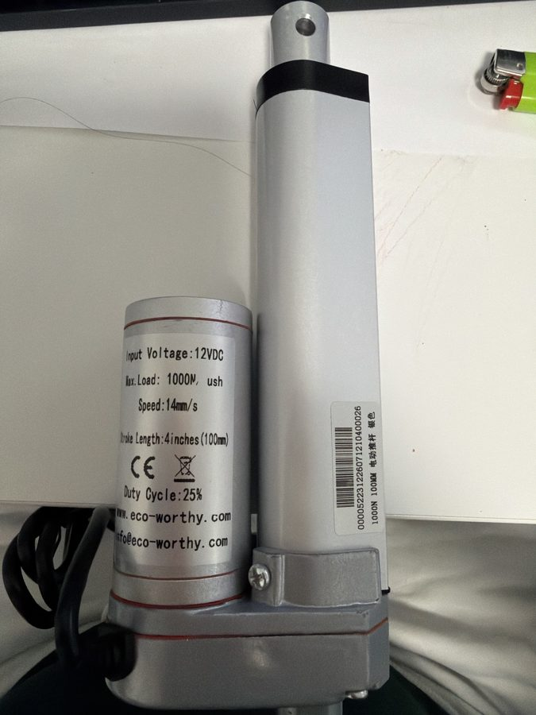 |
| 2 | Heschen electromagnet P40/20, 12 V | Holds the door through steel washers glued to it | 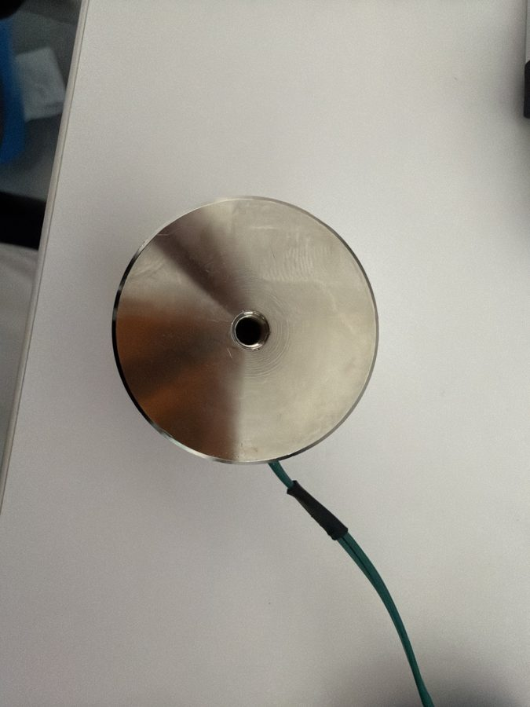 |
| 3 | DS3225 servo, 25 kg | Swings the printed arm with the magnet onto the door | 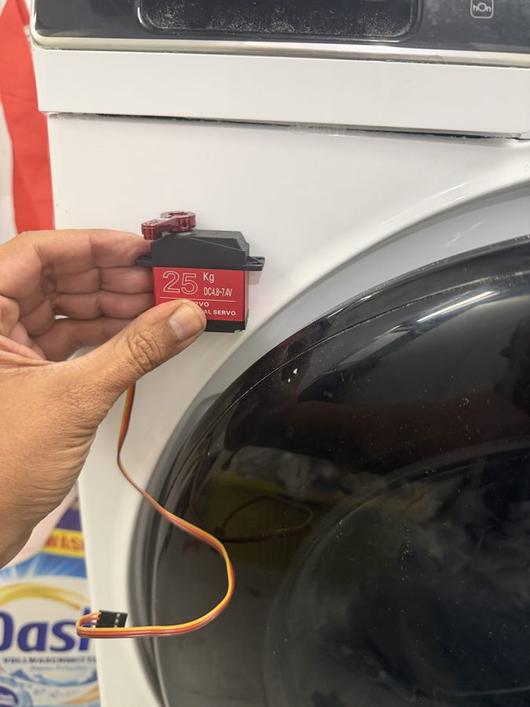 |
| 4 | L298N motor driver | Drives the actuator | 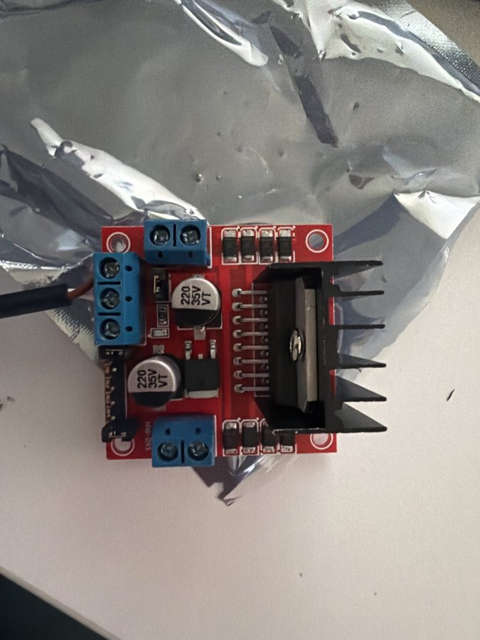 |
| 5 | 12 V 5 A power supply | Powers the actuator and magnet | 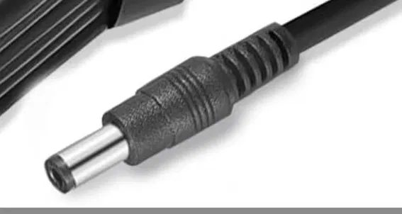 |
| 6 | Raspberry Pi 2 Model B | First controller | 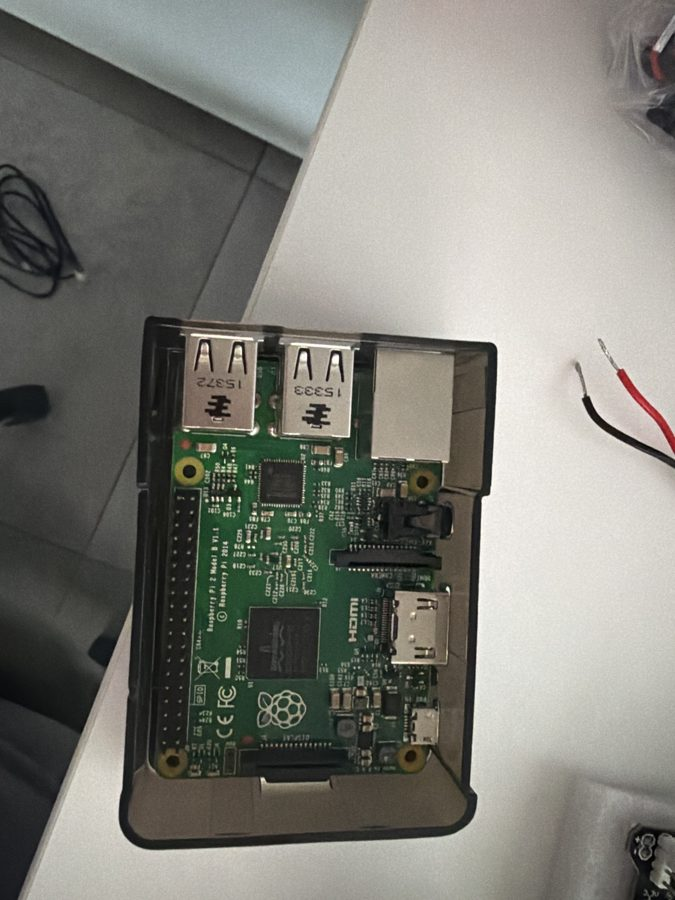 |
| 7 | Servo horn (12-hole disc) | Joins the servo to the arm | 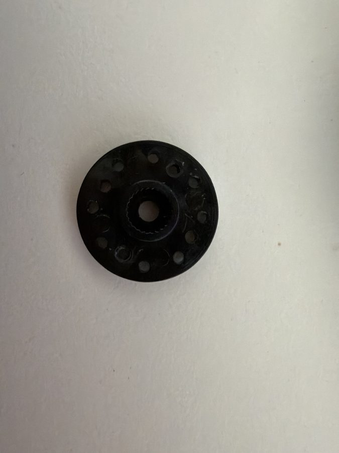 |
| 8 | M5 x 12 screws | Magnet and servo horn mounting | 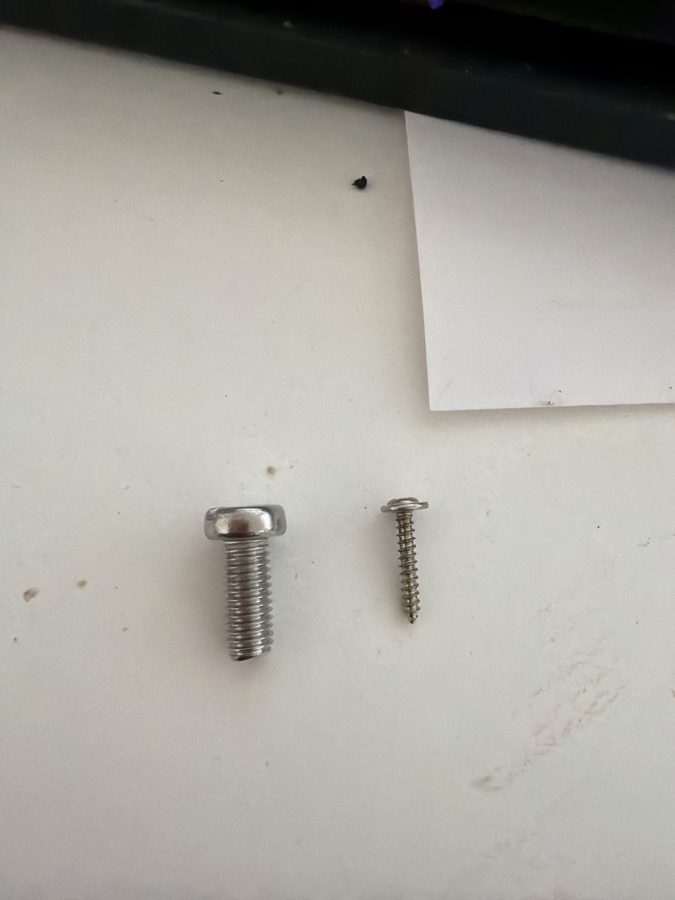 |
| 9 | 3D printed parts: clamp v2 (cradle and cap), swing arm | Hold the actuator and carry the magnet | 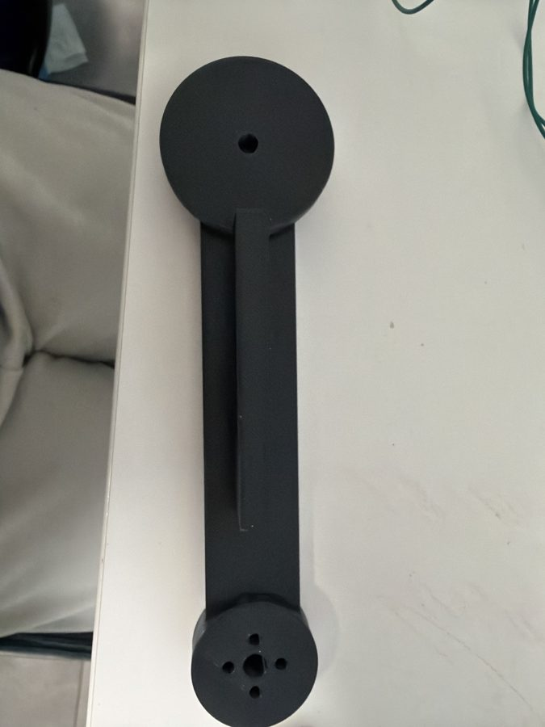 |
| 10 | Galvanised steel washers M12 x 37 x 3 (three) | Steel target for the magnet. Not stainless. | — |
| 11 | 4-channel relay module | Switching | — |
| 12 | Two Kamoer peristaltic pumps | Detergent dosing | — |
| 13 | Shelly smart plug | Mains switching | — |
| 14 | Starter kit with Mega board | Bench electronics | 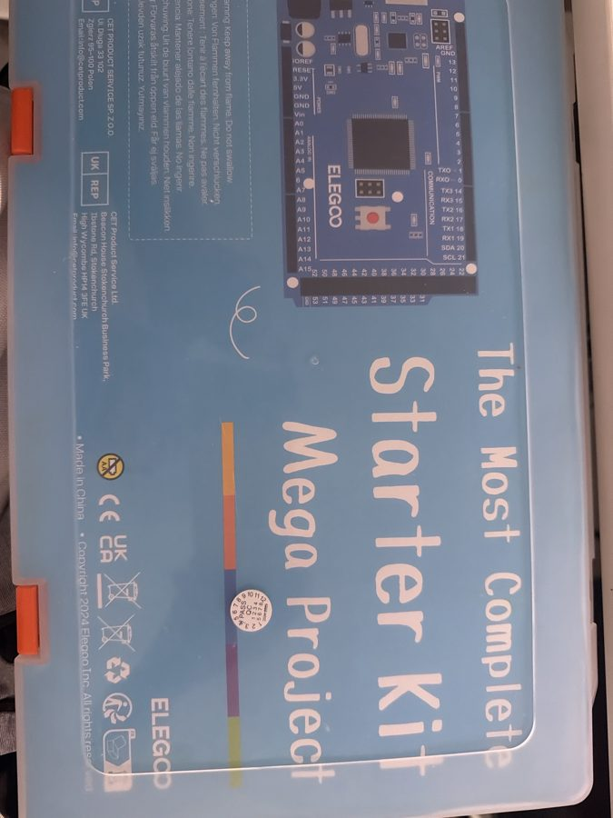 |

Printer: Anycubic Kobra S1, sliced in OrcaSlicer.

## Result

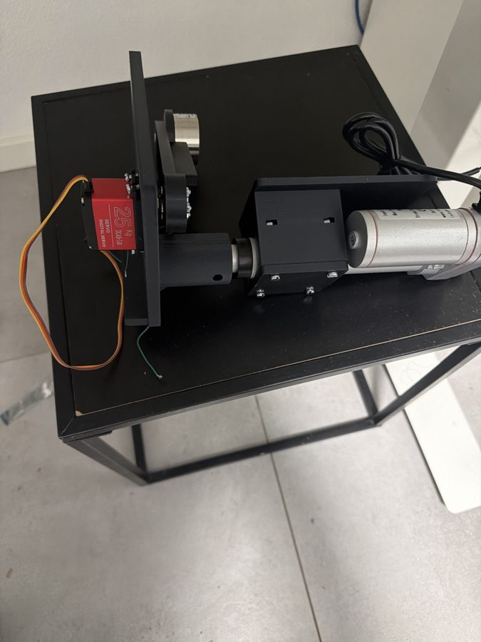

## Build notes

1. Prove the electronics on the bench first: 12 V supply, L298N driver, actuator moves; the electromagnet holds on three washers.
2. Side mount: the actuator lies along the washer's right side wall in the gap to the dryer. A servo at the rod tip swings the printed arm with the magnet onto the door. A fixed bracket in front of the door would block its 90 degree swing.
3. Print clamp v2 as a cradle and cap. The actuator body is a rounded square, so a round bore does not fit.
4. Finish the swing arm by hand: drill the holes, screw the magnet on.
5. Glue three washers side by side on the door. One 30 mm washer was too weak.

## Problems and fixes

| Problem | Fix |
|---|---|
| Printed parts did not fit: round bore, blocked servo holes | Measure first. Clamp redesigned as cradle and cap. |
| One washer too weak for the magnet | Three galvanised steel washers side by side |
| Bracket in front of the door blocks the swing | Side mount with swinging arm |
| Slicer and printer errors on first prints | One part per print job |

## Status

Mechanically complete on 2 November at 20:15. Not installed on the washer. On hold until the robot's arms can grasp.

## Wiring notes

Wiring details are not in the phase notes yet. To add from the build photos: actuator to L298N, magnet to supply, servo signal.
