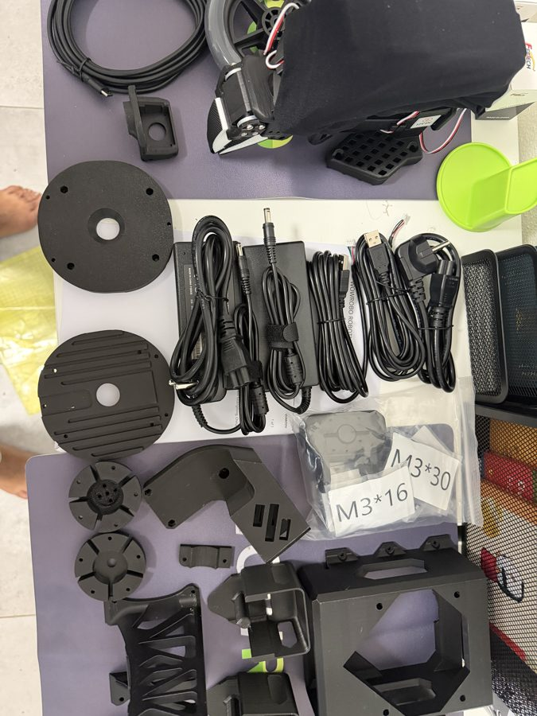
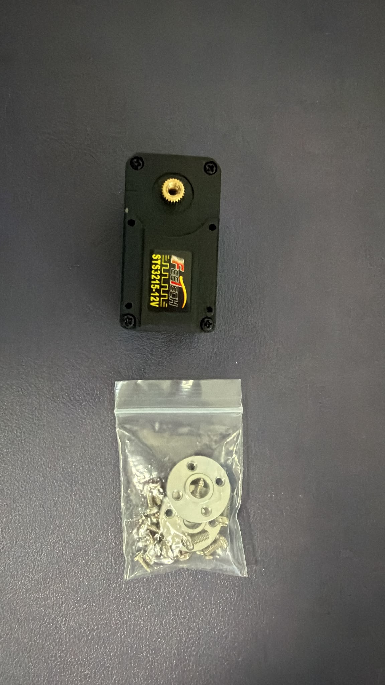
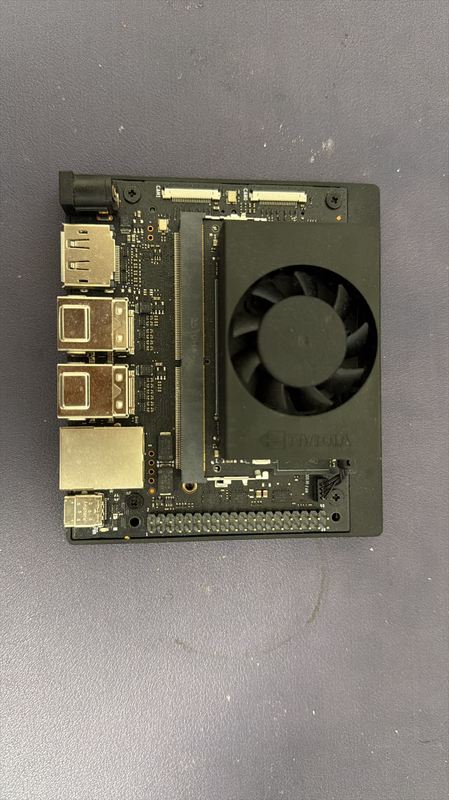
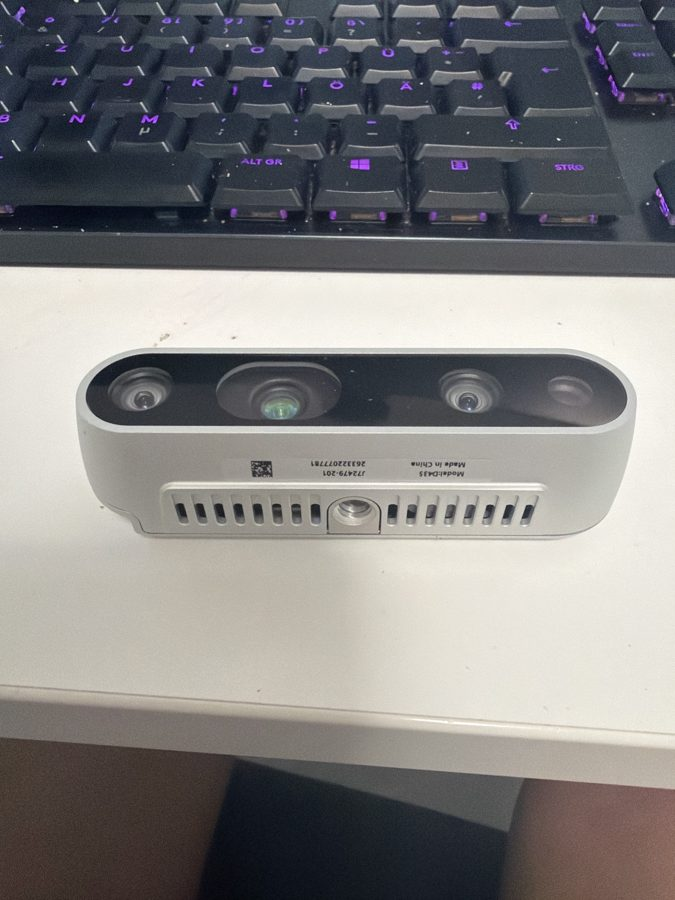
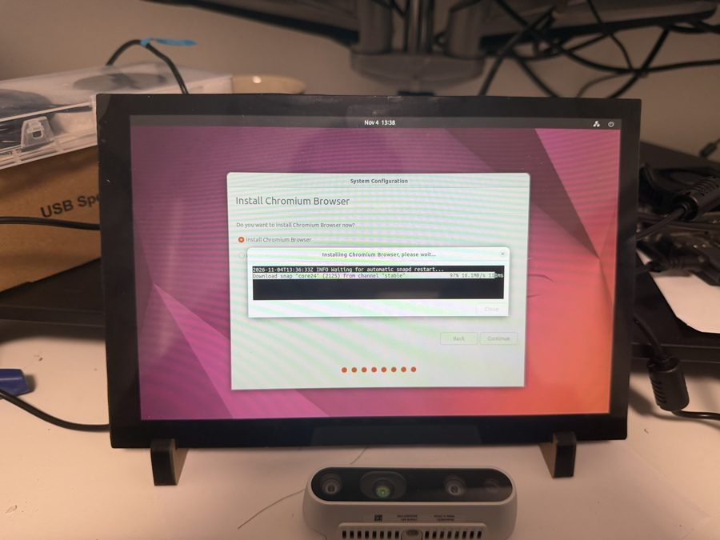
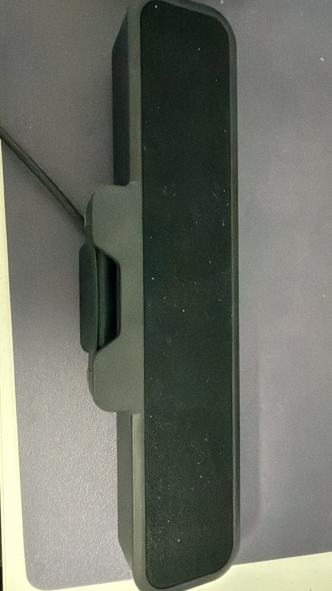
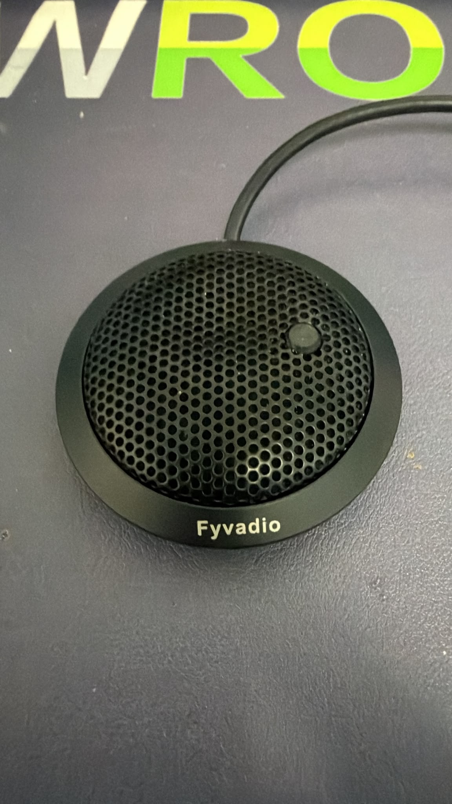
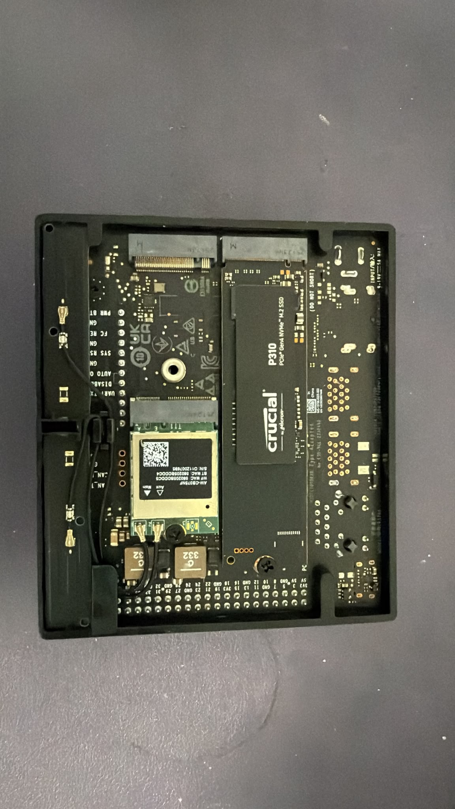
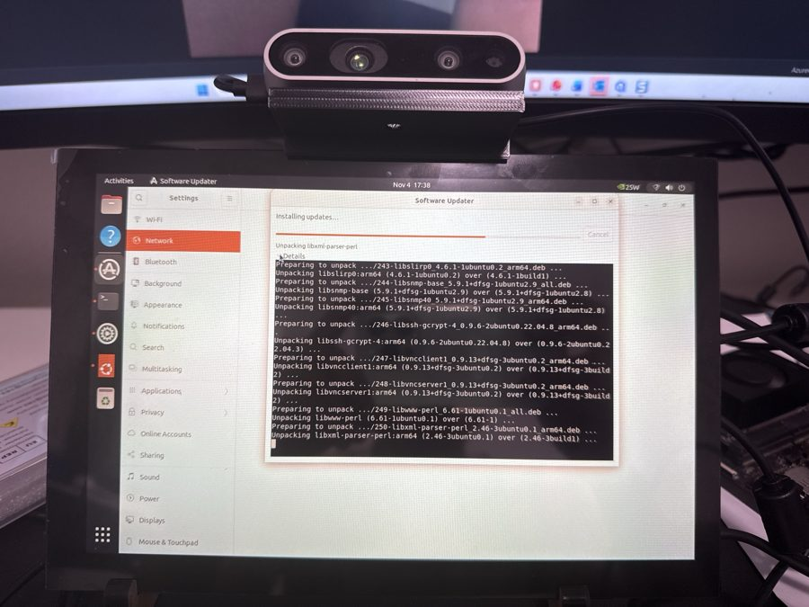

# Phase 2: Robot kit and Jetson setup

1 to 7 November 2026.

## Goal

Change the plan from a fixed arm to a robot that moves around the home, and get a complete two-armed mobile robot running with its computer, cameras and software.

## Bill of materials

Names only. Photos are the real parts from this build.

| # | Component | Used for | Photo |
|---|---|---|---|
| 1 | XLeRobot Package 3 Combo, version 0.4.0 (two assembled SO-ARM101 arms, wheeled base parts, all printed parts) | The robot platform |  |
| 2 | Feetech STS3215 12 V servos (arms), plus four base servos | Arm joints and base drive |  |
| 3 | Two 127 mm omni wheels | Base wheels | photo to add |
| 4 | Three USB cameras (two wrist cameras and one head camera) | Vision | photo to add |
| 5 | Two 12 V 8 A power supplies | Power for the kit | photo to add |
| 6 | NVIDIA Jetson Orin Nano (JetPack 6) | Robot computer |  |
| 7 | Intel RealSense D435 depth camera | Depth and distance |  |
| 8 | ELECROW 10.1 inch touch monitor | Touch screen and face of the robot |  |
| 9 | USB speaker bar (any USB speaker works) | Robot voice |  |
| 10 | USB conference microphone (any USB microphone works) | Hearing |  |
| 11 | 1 TB NVMe drive | System drive, moved from the SD card |  |
| 12 | Printed clip for the depth camera | Holds the camera on top of the screen |  |

> Credit: the arms, the wheeled base parts and the camera mount parts come from the XLeRobot project and its kit (https://xlerobot.readthedocs.io/en/latest/index.html), which is open source under the Apache 2.0 license. The Intel RealSense D435 depth camera was not part of the kit.

Not in the kit: a computer, a battery, a depth camera, a trolley. Later phases add a power station and an own base. A USB 3 cable is needed for the depth camera.

## Build notes

1. Software base: LeRobot with the XLeRobot plugin for the 2-wheel version. LeRobot needs Python 3.12, so the robot software runs in its own environment.
2. Boot the Jetson on the touch screen, join the home network, update.
3. Mount the depth camera on the printed clip on top of the screen.
4. Build the depth camera driver from source, there is no ready package for the Jetson. Read a first live distance.
5. Move the system from the SD card to the NVMe drive. Face enrolment and recognition then worked.
6. Wire as built: head on the right-arm bus, wheels on the left-arm bus. The plugin was patched to match instead of rewiring.
7. Check that the computer finds both servo bus boards and both wrist cameras.

## Problems and fixes

| Problem | Fix |
|---|---|
| The kit has no computer, battery, depth camera or trolley | Jetson already owned, depth camera bought, power station ordered later, own base in phase 5 |
| Robot software needs a newer Python than the Jetson ships with | Separate environment with Python 3.12 |
| No ready depth camera driver for the Jetson | Built the driver from source |
| USB-C to USB-C cable gave only USB 2 speed for the depth camera | Fine for first tests, USB 3 cable needed |
| Jetson froze once in the first depth test | Reboot, no repeat recorded |
| Upstream guide describes a three-wheel base | Corrected in the project's own software map |

## Status

Done. The robot has been running on this setup since 7 November. Next: a USB 3 cable for the depth camera, and using the Jetson's graphics processor for vision.

## Wiring notes

Head servos on the right-arm bus board, wheel servos on the left-arm bus board. Details of connectors are not in the phase notes.
