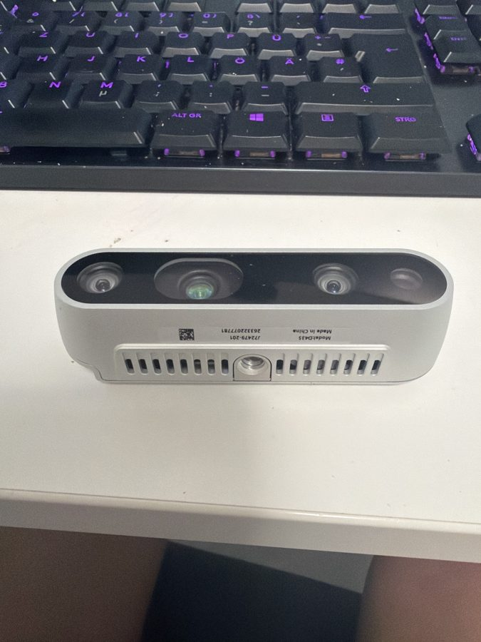
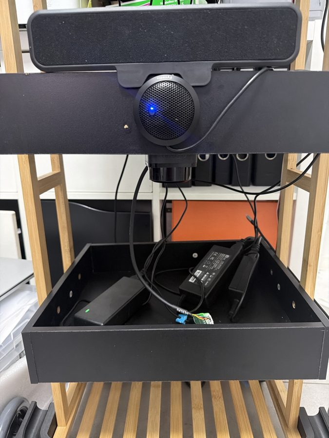
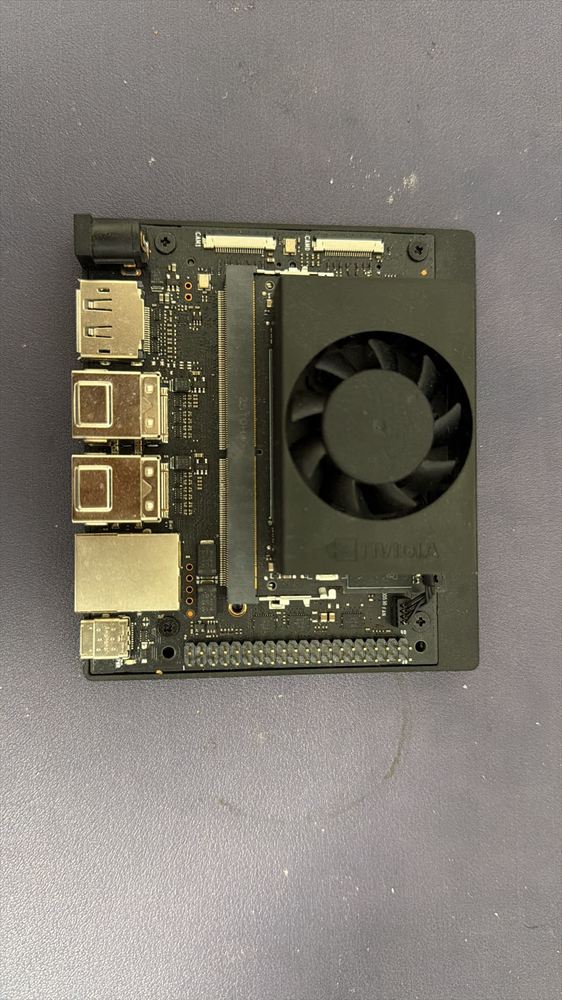

# Phase 3: Depth camera and room mapping

7 to 10 November 2026.

## Goal

Give the robot a picture of the place it stands in. Order: a 3D map first, objects on the map second, tasks third.

## Bill of materials

Names only. Photos are the real parts from this build.

| # | Component | Used for | Photo |
|---|---|---|---|
| 1 | Intel RealSense D435 depth camera | Depth and distance, on the head |  |
| 2 | Two-servo head (pan and tilt) | Turns the camera almost 360 degrees and tilts it | — |
| 3 | Slamtec RPLIDAR C1 2D lidar | Obstacles now, mapping while driving later |  |
| 4 | NVIDIA Jetson Orin Nano | Runs the scans (see Phase 2) |  |

> Credit: the arms, the wheeled base parts and the camera mount parts come from the XLeRobot project and its kit (https://xlerobot.readthedocs.io/en/latest/index.html), which is open source under the Apache 2.0 license. The Intel RealSense D435 depth camera was not part of the kit.

## Build notes

1. Default head pose: looking forward and 45 degrees down. The camera is the highest point of the robot.
2. Scan a room from one spot. The base does not move during a scan. The head takes 27 views with depth and builds a point cloud of about half a million points.
3. A cloud vision model names the objects on the photos. Positions come from the depth data.
4. Mount the 2D lidar at 25 cm height. Lower objects are the camera's job.
5. Do not trust wheel odometry. Positions come from the camera and the lidar.
6. A navigation stack (RTAB-Map with Nav2) is planned, not started.

## Problems and fixes

| Problem | Fix |
|---|---|
| Head left and right swapped in software, early maps mirrored | Found with a camera check, sign corrected, rooms scanned again |
| Robot drove to the wrong desk | Search by meaning: a vision model picks the photo that shows the wanted desk |
| Wheel commands paired wrongly, the robot backed away unseen | The robot measures its own wheel directions with the camera and checks depth in front and behind before every move |
| Depth camera dropped off the USB bus after many restarts | USB reset from software |
| Lidar at 50 cm did not see a 35 cm box | Moved down to 25 cm |
| Object positions from bounding box middles are weak | Fine for a map, not for grasping |

## Status

Done through the lidar mount on 10 November. Navigation stack not started.

## Wiring notes

Wiring details are not in the phase notes yet.
