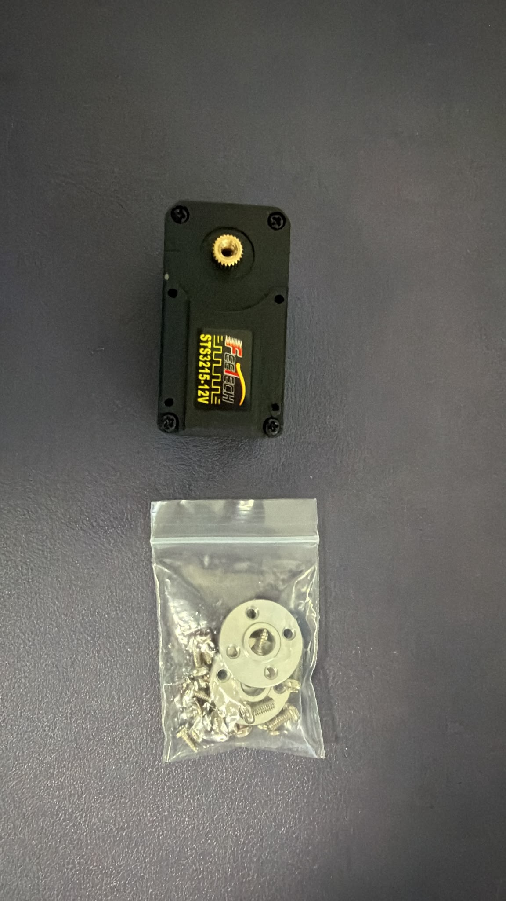
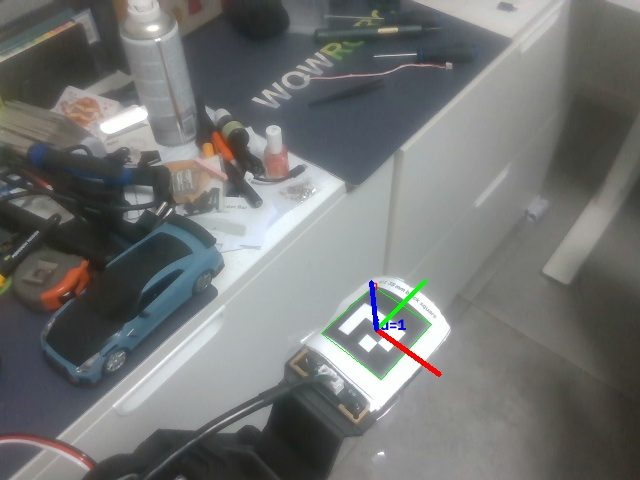
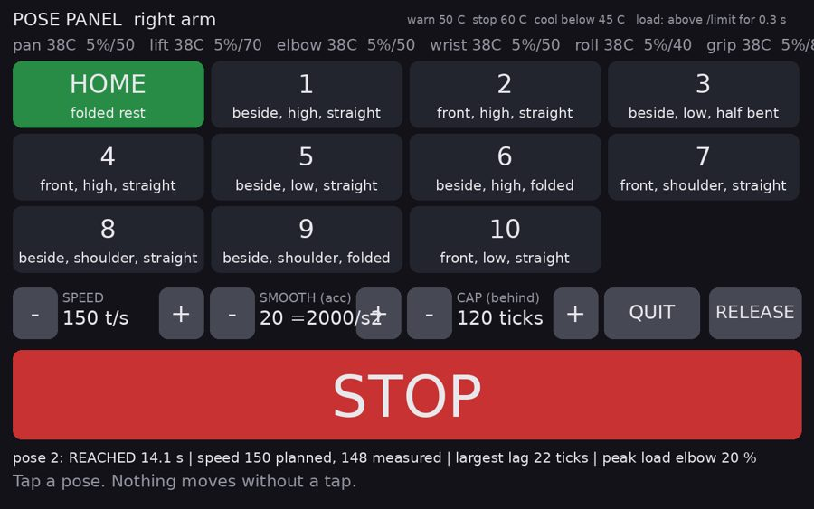
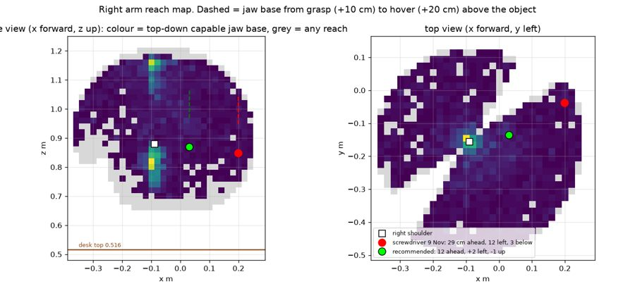

# Phase 4: Arms, servos and grasping

8 to 12 November 2026.

## Goal

Make the two arms move accurately and safely, and pick up a first object using geometry (calibration, kinematics, the camera) and no trained policy.

## Bill of materials

Names only. Photos are the real parts from this build.

| # | Component | Used for | Photo |
|---|---|---|---|
| 1 | Two SO-ARM101 arms | Manipulation (from the kit in Phase 2) | — |
| 2 | Feetech STS3215 servos, 12 V, 30 kg.cm (six per arm including the gripper) | Arm joints and gripper |  |
| 3 | Spare STS3215 servos (two) | Replacing the burnt and seized servos | — |
| 4 | 35 mm ArUco marker, printed, on the back of the wrist camera board | Camera-to-arm calibration |  |
| 5 | Head camera (Intel RealSense D435) | Checks the arm model and watches servo wiggle tests | — |
| 6 | Touch screen pose panel (software) | Moves each joint and drives home pose plus ten free poses |  |

> Credit: the arms, the wheeled base parts and the camera mount parts come from the XLeRobot project and its kit (https://xlerobot.readthedocs.io/en/latest/index.html), which is open source under the Apache 2.0 license. The Intel RealSense D435 depth camera was not part of the kit.

## Reach map of the right arm

## Build notes

1. Calibrate joint by joint from the real end stops, not from a middle pose.
2. Verify the arm model with the head camera and the printed marker: 0.7 cm average error.
3. Inverse kinematics with the placo library on a fixed-base copy of the robot model.
4. Rule: never call a target out of reach from the model alone. The robot proves a limit by moving there and photographing it.
5. Arm guard: live temperature of every servo, stop at 60 degrees, stop when a joint is stuck short of its goal.
6. Self-collision table from 10,000 random poses per arm.
7. Plan a first grasp offline for a small cube: hover, grasp, lift.

## Problems and fixes

| Problem | Fix |
|---|---|
| Right gripper servo jammed | Mechanical, fixed by hand |
| Left wrist servo overheated to 93 degrees and seized | Swapped for a spare |
| New servo answered only sometimes | Bad cable seat, servo was good. Bus reliability check written |
| Two servo numbers swapped after the repair | Found by wiggling each servo while the head camera watched |
| Floating base joint moved in place of the arm | Fixed-base copy of the model |
| Nothing on the desk was in reach: the arm reaches 0.41 m, top-down grasp works about 0.12 to 0.30 m in front of the shoulder | This finding led to the vertical lift (Phase 5) |
| Right elbow servo burnt in a limit test | Replaced the same day, temperature and stall stops added |
| Joint limits depend on the pose of other joints | Self-collision table |

## Status

Arms move accurately and safely, a screwdriver was held when placed in the gripper by hand. The left arm is parked to focus on the right arm.

## Wiring notes

Wiring details are not in the phase notes yet. Known: a bad cable seat looks like a bad servo, test the cable first.
