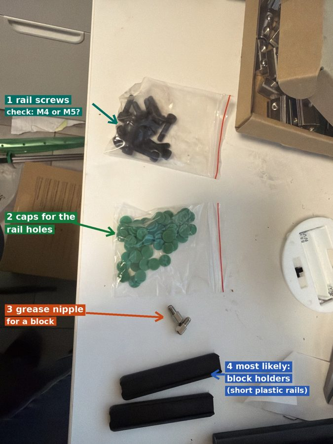
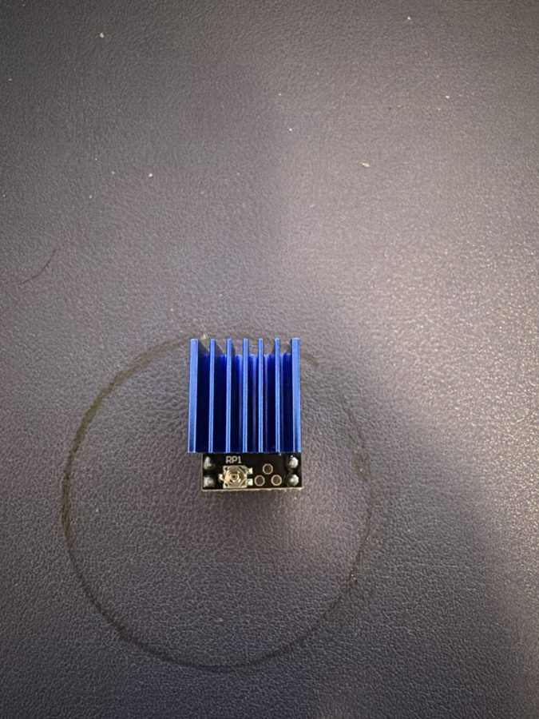
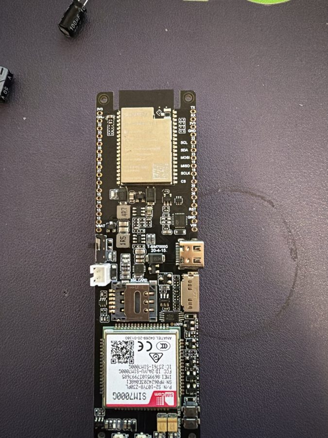
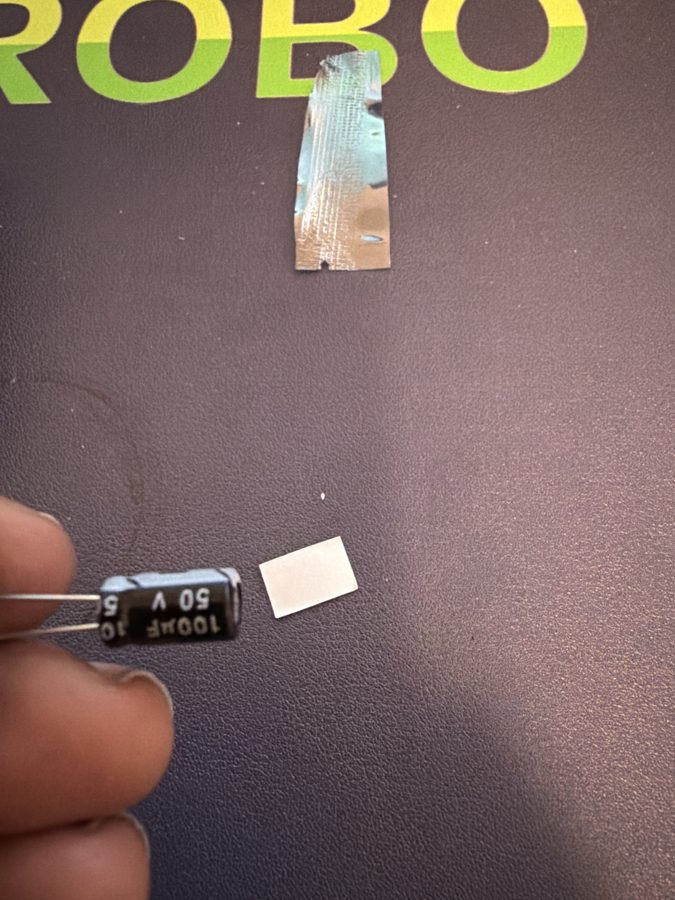
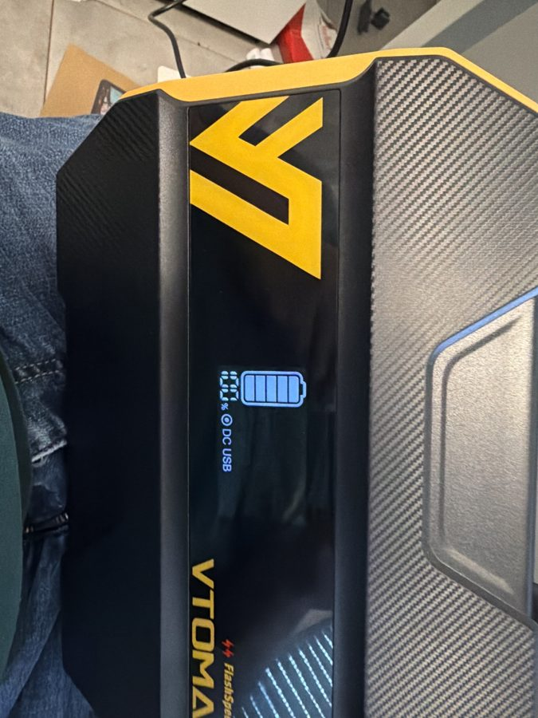
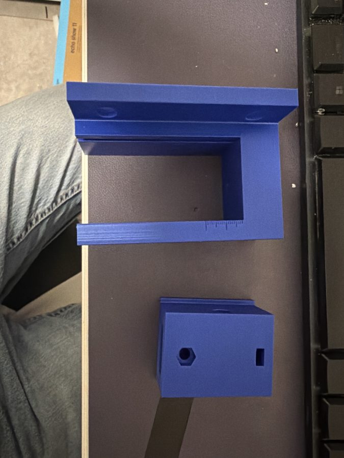
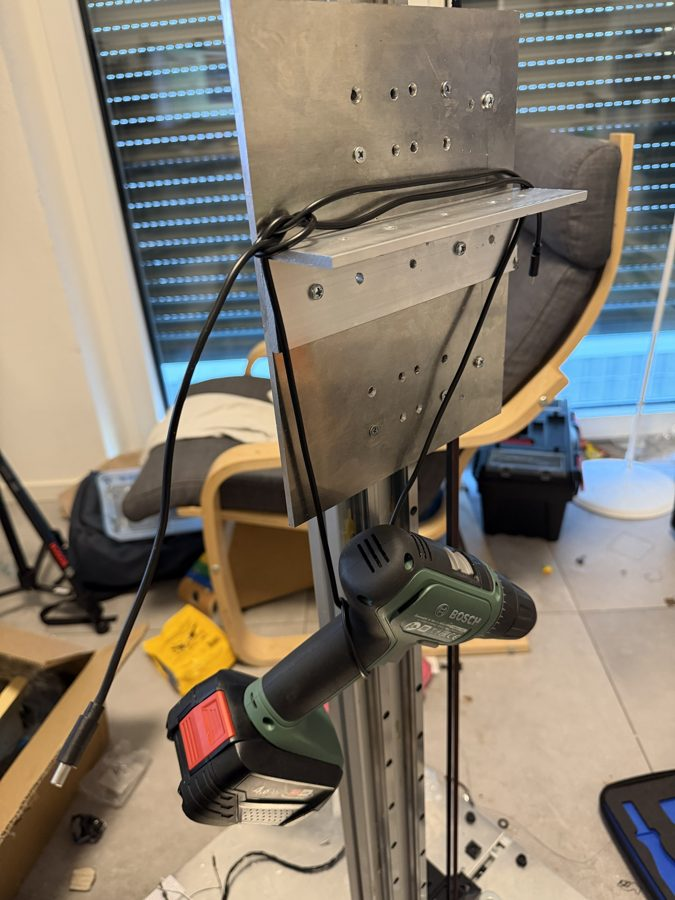
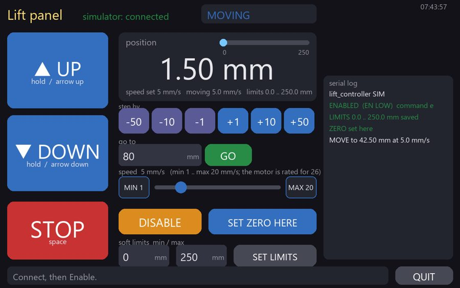

# Phase 5: Base frame and vertical lift

8 to 19 November 2026.

## Goal

Replace the kit's trolley with an own base and add a vertical lift, so the arms can work from the floor up to shelf height. The arms are too short to reach a desk or the floor from a fixed height (Phase 4).

## Bill of materials

Names only. Photos are the real parts from this build.

| # | Component | Used for | Photo |
|---|---|---|---|
| 1 | Mast: 40 x 80 slot-8 aluminium profile, 1500 mm | Vertical column | photo to add |
| 2 | Two HGR15 rails, 1500 mm, with four HGH15CA blocks | Guide the carriage |  |
| 3 | Carriage plate: AlMg3 200 x 250 x 5 mm | Carries the torso, arms and head | photo to add |
| 4 | Aluminium angle 50 x 50 x 5 mm | Shelf that carries the torso | photo to add |
| 5 | Two aluminium plates 300 x 500 x 5 mm on a 40 x 40 frame (cross bar 420 mm, side bars 538 mm) | Deck of the base | photo to add |
| 6 | STEPPERONLINE 17HS15-1684S-PG5 (NEMA 17 with 5.18:1 gearbox) | Lift motor | photo to add |
| 7 | GT2 belt, 6 mm, with 20-tooth pulley (8 mm bore) and a toothed idler | Belt drive | photo to add |
| 8 | TMC2209 stepper driver | Drives the motor |  |
| 9 | LilyGO T-SIM7000G (ESP32) | Lift controller |  |
| 10 | Capacitor 100 uF, 50 V | Across the driver's supply |  |
| 11 | Small push button | Software stop | photo to add |
| 12 | Anker SOLIX C300 DC power station | Power for the robot, on the base |  |
| 13 | 3D printed motor box, belt tensioner (version 2, with 22 mm lock slot) | Hold the motor square and keep the belt tight |  |
| 14 | Cordless drill (1.5 kg) | Test load on the carriage |  |

Bought but not fitted: a ball screw set and a worm gear motor, and a spring balancer.

## Lift control panel

## Build notes

1. Full-height rail lift, chosen because the floor matters.
2. Build the deck frame: bar cut in three pieces, H-shaped frame under two aluminium plates.
3. Bolt both rails to the wide face of the mast (8 screws each). Rails on opposite faces cannot share one flat carriage plate.
4. Put the carriage plate on the four blocks. Fix the belt idler at the top.
5. Layout: motor at the bottom, tensioner at the top.
6. Run motor, driver and controller on the table first. 207.2 microsteps per millimetre, travel about 1.2 m.
7. Print a motor box, then a belt tensioner. Print one part per job.
8. Test: the lift runs 300 mm up and down at up to 20 mm per second and carried a 1.5 kg drill on the carriage.

## Problems and fixes

| Problem | Fix |
|---|---|
| Wrong parts in the first order: 5 mm bore pulleys for an 8 mm shaft, carriage plate too small | Right pulley and a 200 x 250 plate bought. The review before buying became a rule. |
| Belt slipped off the pulley under load | Motor box to hold the motor square, then a real tensioner at the top |
| First tensioner frame was mirrored | Version 2 of the frame only |
| Lock slot removed by mistake in the redesign | Put back, 22 mm long |
| Up button moved the carriage down | Direction flag in the firmware |
| Soft limits blocked moving below the power-on position | Made settable from the panel |
| Doubt that the small belt can carry the full body | Open. Load test with water bottles still to do. |
| Carriage falls when the motor is unpowered | Open. A spring balancer was bought, not trusted yet. |

## Status

The lift works over 300 mm at up to 20 mm per second. Two items are open: a full-load test, and holding the carriage when unpowered.

## Wiring notes

Table test wiring: power station to the TMC2209 driver (with the 100 uF capacitor across the supply), ESP32 pins to the driver's step, direction and enable, a stop button to the ESP32, motor to the driver. Exact pin numbers are in the project's wiring diagram, not copied here yet.
