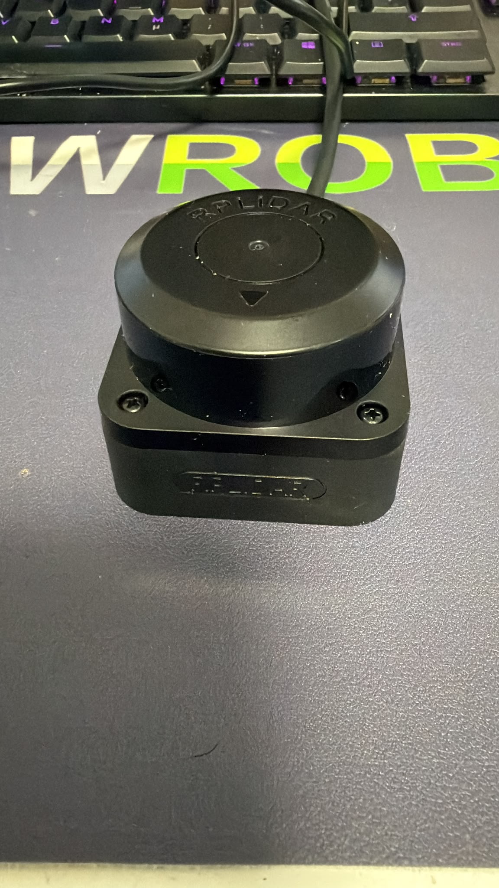
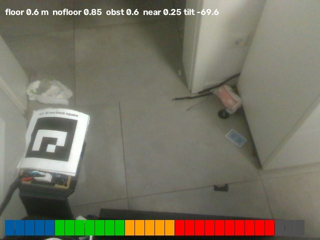
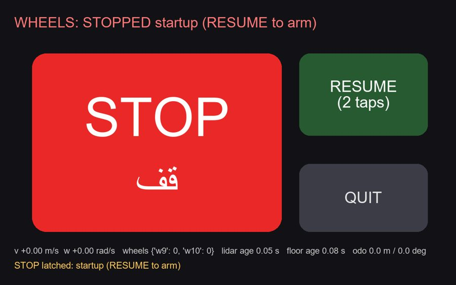
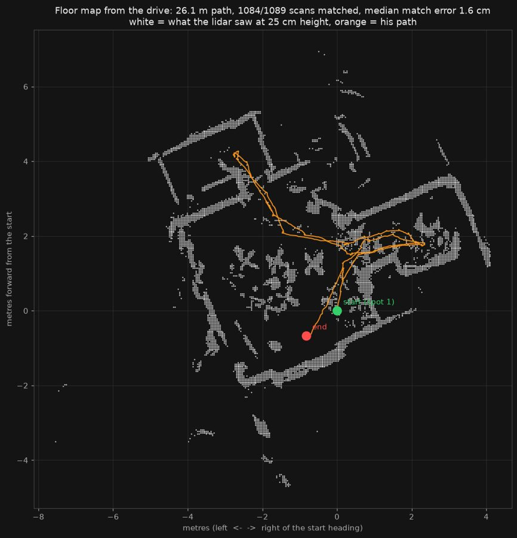

# Phase 6: Safe driving and navigation

16 to 17 November 2026.

## Goal

Let the robot move through the home without hitting anything or falling down stairs, first by remote control and then by itself to a named place such as the kitchen.

## Bill of materials

Names only. Photos are the real parts from this build.

| # | Component | Used for | Photo |
|---|---|---|---|
| 1 | Slamtec RPLIDAR C1, 25 cm above the floor | Obstacle stop and floor map |  |
| 2 | Intel RealSense D435 depth camera | Floor check at 15 times per second |  |
| 3 | Two kit omni wheels (differential drive) | Driving | — |
| 4 | Phone with a web browser on the home network | Remote control with hold-to-drive buttons and a stop |  |
| 5 | Small cliff sensors (ordered, not fitted) | Planned second stair check | — |

## First floor map built from a phone-driven drive

## Build notes

1. One program owns the wheels. Everything else has to ask it.
2. Wheel guard: speed capped at 0.15 m per second and 0.5 radians per second. Stop when the lidar sees something within 0.35 m in the driving direction. Stop when sensor data is older than 0.3 seconds. Dead-man timer. A latched stop that only a person can release.
3. Floor watcher: where the depth camera sees no floor (stairs, a drop), forward driving is refused.
4. Phone remote: a web page on the home network with hold-to-drive buttons and a stop.
5. Drive the robot by phone through the home to build a floor map. A vision model names the areas from the robot's photos, a person checks them.
6. When driving by phone the owner is responsible: obstacle rules warn and do not block. The stair check, release-to-stop, stop button and speed limits stay. Automatic driving keeps every block.
7. First automatic drive towards the kitchen: 0.8 m, stopped by its own guard 0.68 m before an obstacle.

## Problems and fixes

| Problem | Fix |
|---|---|
| A review of the first day found faults before any were fixed | Listed, then fixed on the owner's word |
| First planner drive only partly successful | Fixes the same evening, stop latched afterwards |
| The phone remote did not move the robot one morning | Fixed |
| Robot could not find its position from one lidar scan | A clean map from a new drive fixed it for that area |
| Position guessed from camera photos was wrong by 0.8 m and 36 degrees | The lidar map does the positioning, the camera only names the part of the room |
| The robot's front is 11 degrees off its real driving direction | Measured, correction still open |
| Small cliff sensors ordered as a second stair check | Not fitted yet |

## Status

Driving by phone works with a guard layer. First automatic drive: 0.8 m towards the kitchen. A ready-made navigation algorithm (the owner named NoMaD) is wanted and not installed.

## Wiring notes

Software phase. No new wiring.
