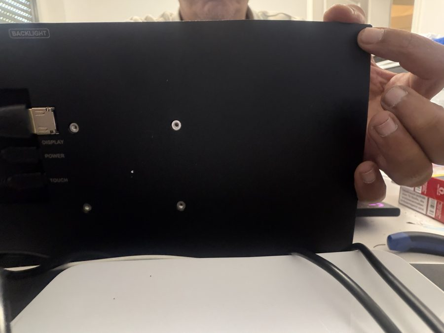
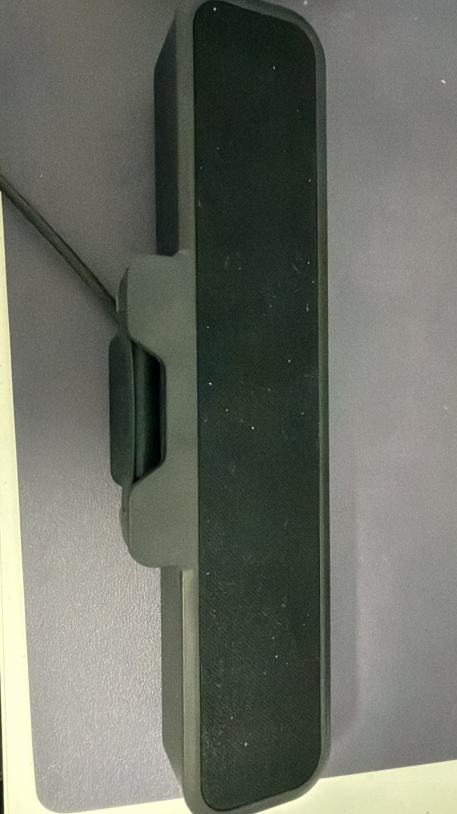
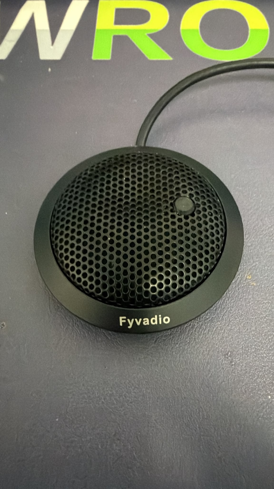
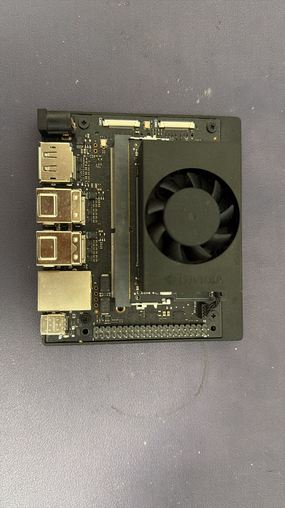
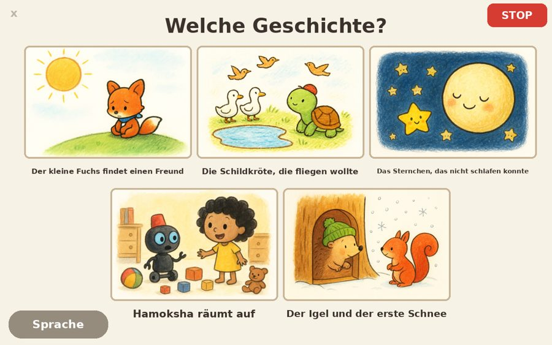

# Phase 7: Voice, storytelling and kids

5 November, then 16 to 17 November 2026, in daily use since.

## Goal

Give the robot a voice and a face, and make it useful to the family: tell stories and run small learning games for the children in German and Egyptian Arabic.

## Bill of materials

Names only. Photos are the real parts from this build.

| # | Component | Used for | Photo |
|---|---|---|---|
| 1 | ELECROW 10.1 inch touch monitor | Screen: face, story menu, kids screen |  |
| 2 | USB speaker bar (any USB speaker works) | Robot voice |  |
| 3 | USB conference microphone (any USB microphone works) | Hearing the children |  |
| 4 | NVIDIA Jetson Orin Nano | Runs everything on the robot (see Phase 2) |  |
| 5 | Voice backends behind one interface: OpenAI Realtime, Azure, Gemini Live, a local test path | Live conversation (software, cloud services) | — |

## Story menu on the robot's screen

## Build notes

1. Voice backends sit behind one interface and were measured: OpenAI about 0.55 s to the first word, Azure about 1.2 s, Gemini about 2.5 s and cheapest.
2. Staying on the robot whatever the backend: voice activity detection, the eyes, device control.
3. Story texts are written for the robot, not generated live. Pictures and voice clips are built once and stored on the robot.
4. Five stories, five scenes each, in German and Egyptian Arabic. Each scene has a picture and a question.
5. The robot listens to the children's answers, then a live voice lets it talk with them.
6. Four long stories, a paged menu, a kids screen, a screen that follows a face with the head and greets, and eight learning games.
7. Update base: the robot pulls new software from a repository, checks it, switches over and can roll back. Updates never interrupt the children's screen.
8. Autostart at login so the children's screen comes back after a power loss.

## Problems and fixes

| Problem | Fix |
|---|---|
| No sound although the software reported playing | The desktop's sound service held the speaker. The story player now plays through that service. |
| Robot did not react to the children's answers | Listening added, then the live voice |
| First answer 5.4 s late in a noisy room | Live voice brought the first audio to about 0.44 s |
| Story window shrank from full screen | Put back from outside without a restart |
| Jetson rebooted while building the long stories | Story time brought back, later made to start by itself |
| Nothing started after a power loss | Autostart at login, proven on a real boot on 17 November |
| Face recognition of the children slowed the fun down | Skipped, the children wanted to play |

## Status

In daily use as a storyteller since 17 November.

## Wiring notes

USB speaker bar and USB microphone plug into the Jetson. No other wiring.
