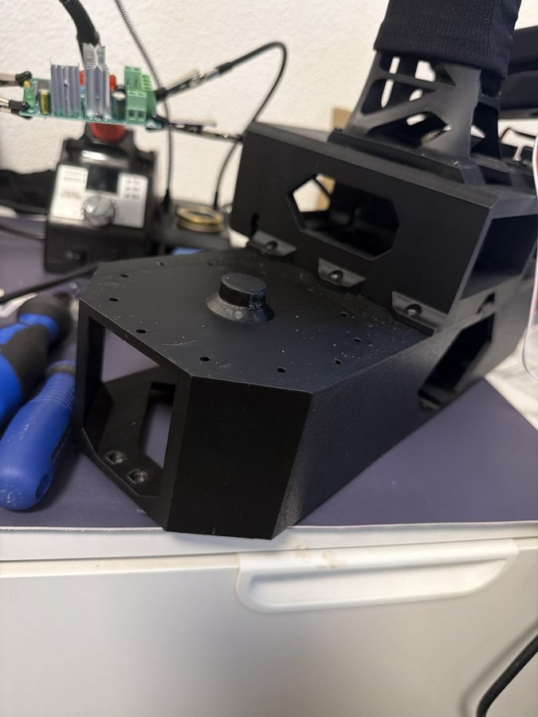
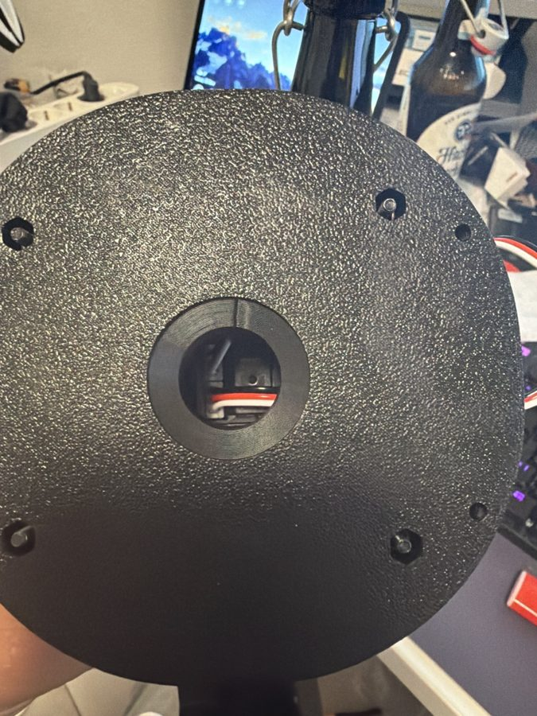
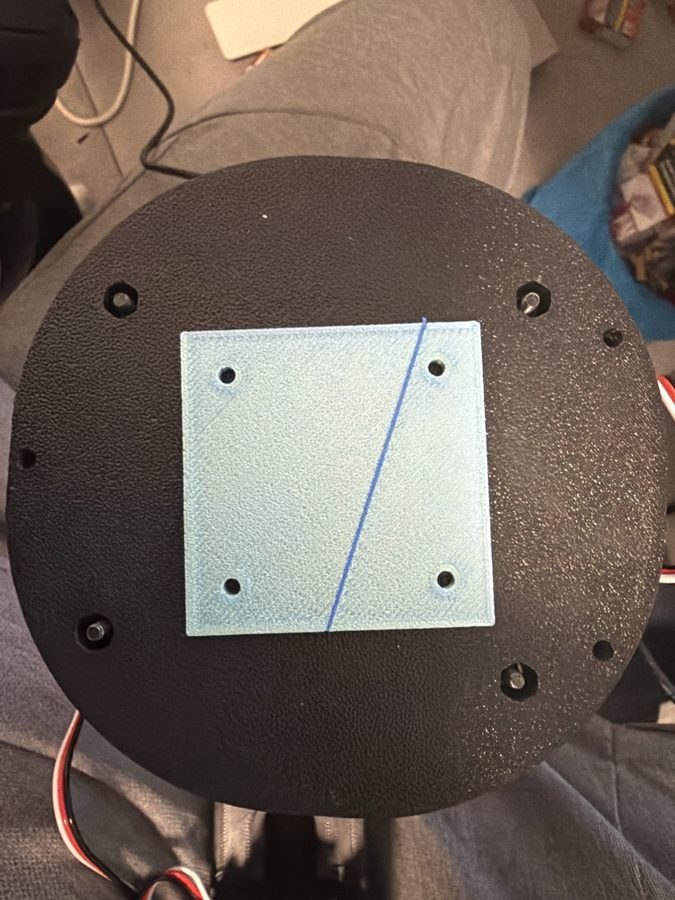
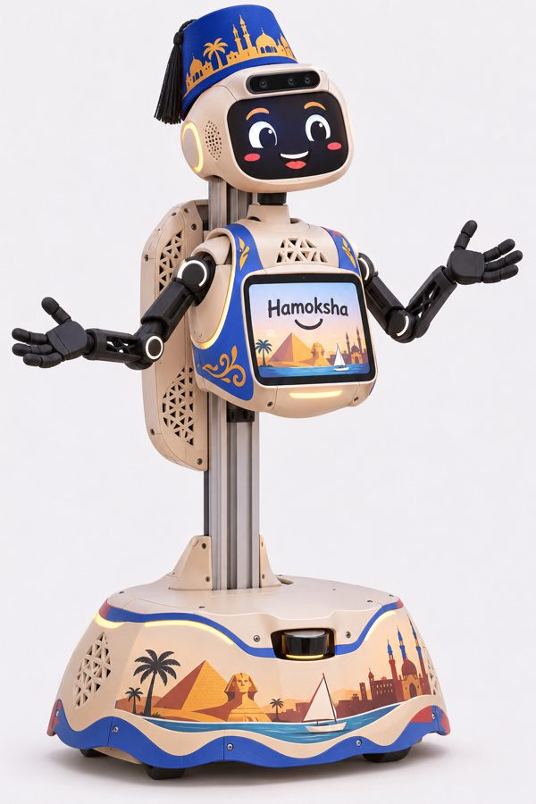
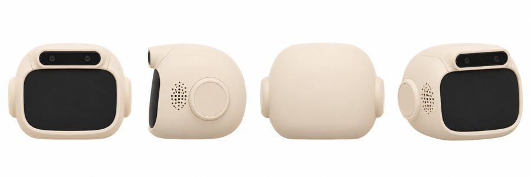
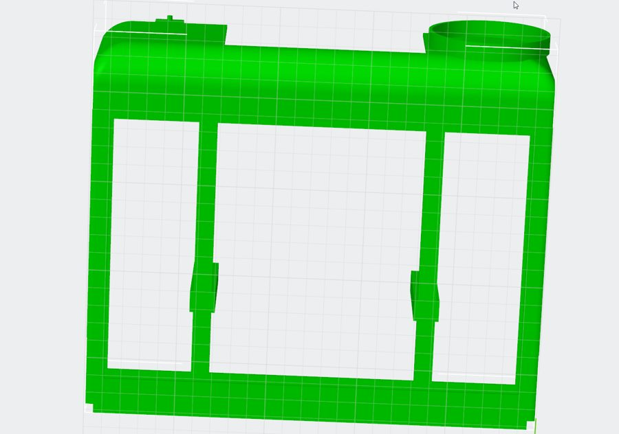
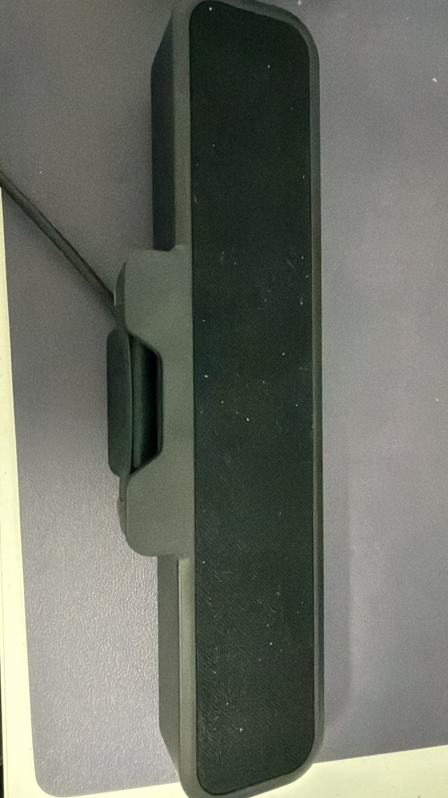
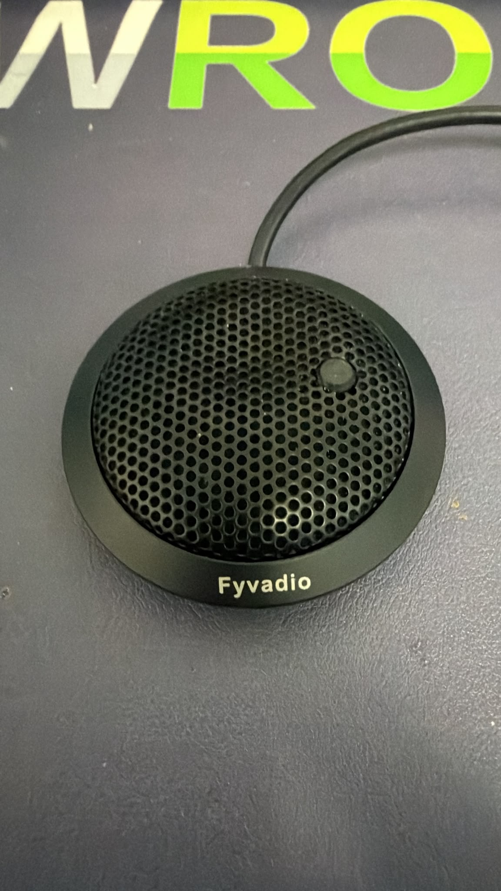
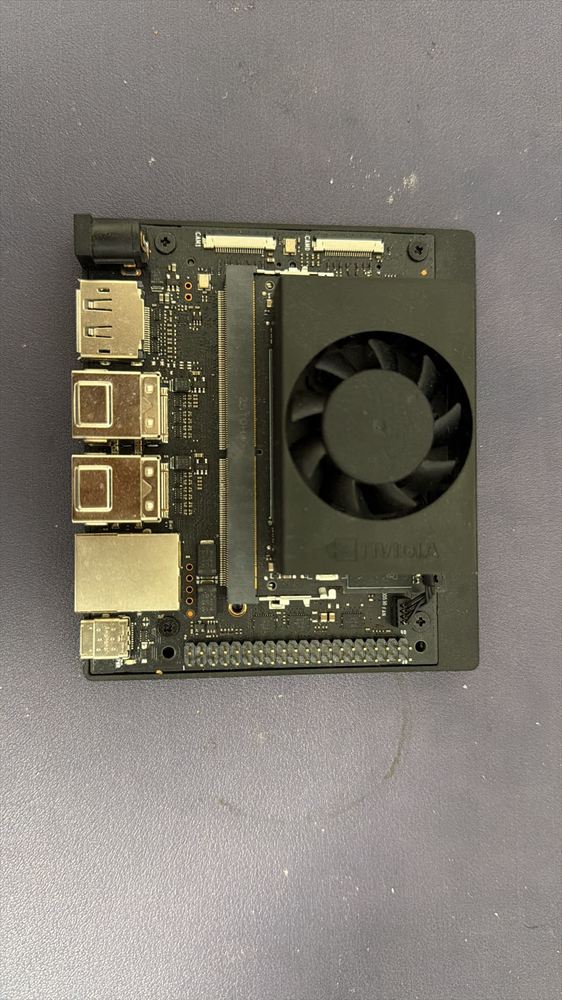
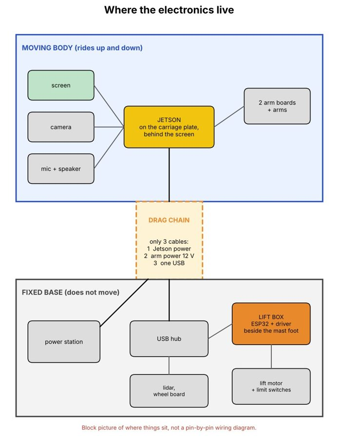

# Phase 8: Body design, arms and screen

13 to 23 November 2026.

## Goal

Give Hamoksha a body: a friendly, human-like character that hides the mechanics. Decide where the arms, head, screen and electronics sit on the moving carriage, and start printing the shell.

## Bill of materials

Names only. Photos are the real parts from this build.

| # | Component | Used for | Photo |
|---|---|---|---|
| 1 | Two printed shoulder blocks (cone-and-cylinder boss copied from the kit's old base box) | Hold each arm's kit disc upright at the end of the shelf |  |
| 2 | Arm kit discs, 111.35 mm across, 10.75 mm thick, stepped centre hole 30 to 20 mm (from the kit) | Arm mounting |  |
| 3 | Printed test piece for the disc fit | Proved the fit before printing the blocks |  |
| 4 | Body shell, printed in pieces of at most 250 mm (blue and cream filament) | Outer skin |  |
| 5 | Printed head, rides on the kit's neck | Head with the depth camera |  |
| 6 | ELECROW 10.1 inch touch screen, 239.4 x 157.4 x 12 mm, in a printed front frame | Belly screen |  |
| 7 | USB speaker bar (any USB speaker works), 248 mm long | Voice, along the bottom front (sets the body width of about 255 mm) |  |
| 8 | USB conference microphone (any USB microphone works) | Top front |  |
| 9 | NVIDIA Jetson Orin Nano | On the carriage plate behind the screen |  |
| 10 | Drag chain (three cables go down to the base) | Cable guide | photo to add |

> Credit: the arms, the wheeled base parts and the camera mount parts come from the XLeRobot project and its kit (https://xlerobot.readthedocs.io/en/latest/index.html), which is open source under the Apache 2.0 license. The Intel RealSense D435 depth camera was not part of the kit.

## Where the electronics live

## Build notes

1. Method: ChatGPT draws the look, Meshy turns the picture into the outer shape, CAD scripts cut the exact openings and fixing points and split the shell into pieces of at most 250 mm.
2. Hardware is the fixed reference. The shell is made to fit it, never the other way round.
3. Arms on the sides, like shoulders. Each arm's kit disc stands upright on a printed block at the end of the shelf.
4. Measure before printing: the disc (three caliper measurements, thickness) and the shelf height, which is 160 mm.
5. Head rides on the carriage with the body, on the kit's neck. The depth camera stays bare for now so it keeps working.
6. Screen on the front, Jetson behind it, speaker along the bottom front, microphone at the top front.
7. Build the shell in three steps: outer skin, fit to the hardware, one test piece.
8. Print the front screen frame. Fill the middle of the screen's back piece with a plate and four holes for the screen's own screws.

## Problems and fixes

| Problem | Fix |
|---|---|
| Body renders by the coding assistant were not liked | Picture-to-3D route, one plain colour first |
| Boss on the test piece drawn as a flat step, twice | Cone and cylinder from the measured old part, the printed piece fitted |
| First study recommended arms on top | Sides chosen for the look. Load on that joint is up to 57 percent of the servo limit with 200 g in hand. |
| A full round head that turns would hit the mast, only 49 mm between camera and belt tensioner | Two options drawn, decision postponed |
| Screen frame made for a guessed shelf height of 125 mm | Shelf measured at 160 mm, frame corrected before printing |
| With the shelf at 160 mm the right arm disc meets the tensioner | Top limit of the lift set 42 mm lower |
| Screen's own back cover and a post of the frame broke | Back piece kept, middle filled with a plate |
| Neck's feet hang over the 50 mm shelf | Open: neck fixing not designed |

## Status

Layout declared fixed on 22 November. Shell in progress. Open: the neck fixing and the head decision.

## Wiring notes

Only three cables go down to the base through a drag chain. Details are not in the phase notes yet.
