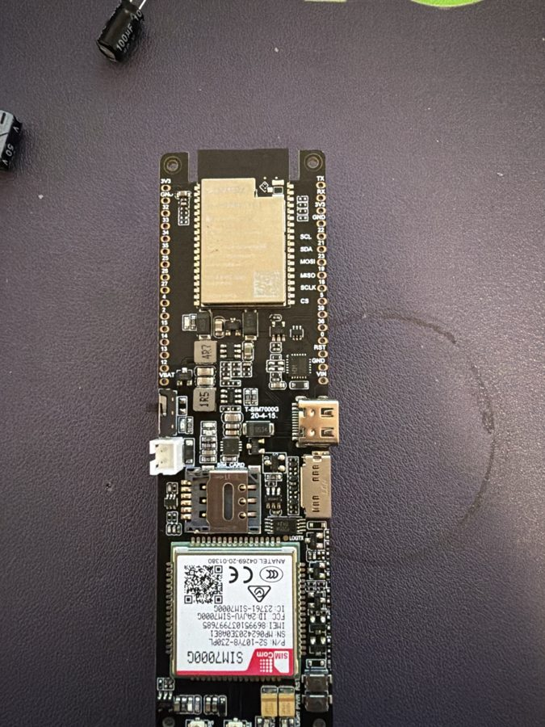
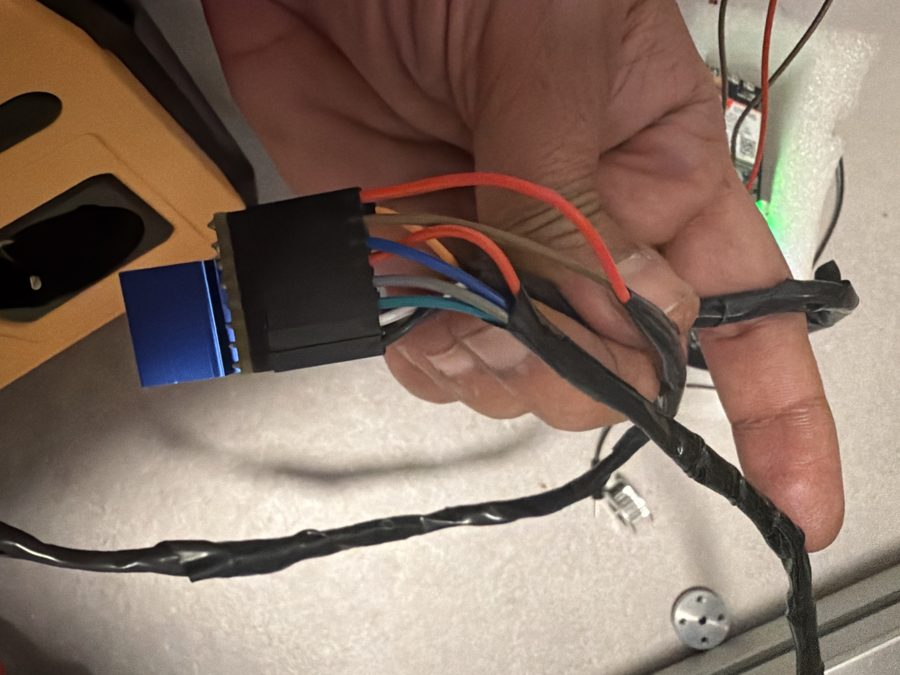
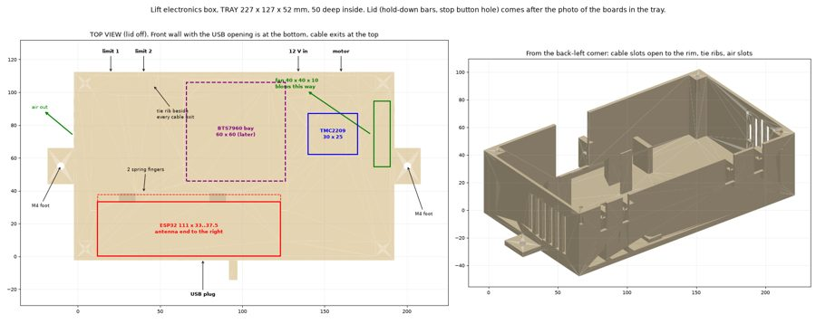
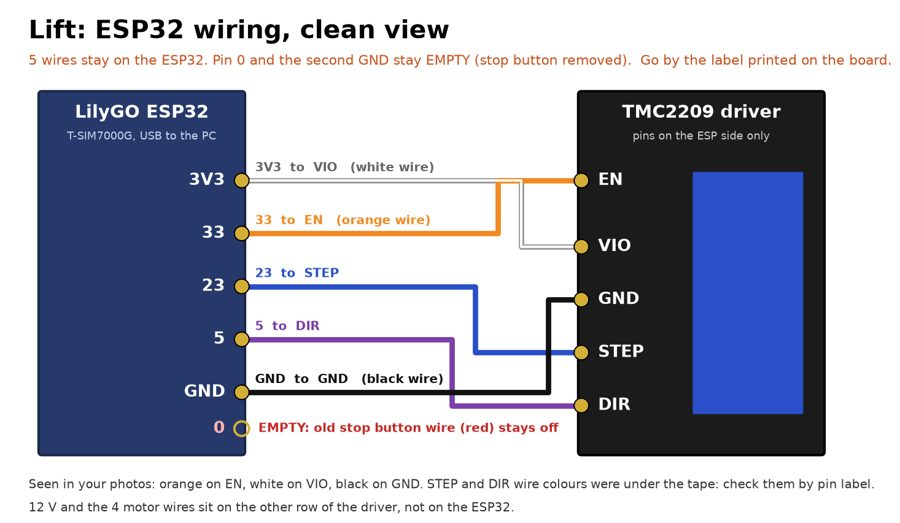

# Phase 9: Lift debugging and electronics box

17 to 18 November and 22 to 23 November 2026.

## Goal

Find out why the lift motor stopped moving, twice, and make the lift's electronics reliable.

## Bill of materials

Names only. Photos are the real parts from this build.

| # | Component | Used for | Photo |
|---|---|---|---|
| 1 | LilyGO T-SIM7000G (ESP32) | Lift controller |  |
| 2 | TMC2209 V2.0 stepper driver (plus a spare) | Drives the lift motor |  |
| 3 | Motor 17HS15-1684S-PG5 | Lift motor | photo to add |
| 4 | Stop button | Hardware stop, to go back into the box lid | photo to add |
| 5 | Printed electronics box tray, 227 x 127 x 52 mm (not printed yet) | Holds boards with their own cable exits and tie points |  |
| 6 | Drag chain with three cables | Between the box on the fixed base and the Jetson on the moving body | photo to add |
| 7 | Multimeter | Voltage and coil resistance checks (never done on this fault) | photo to add |

## Lift ESP32 to driver wiring

## Build notes

1. Pins: enable on 33, step on 23, direction on 5, stop button on 0.
2. The lift program takes text commands over USB: enable, stop, jog up and down, move by, go to, speed, zero, limits, status.
3. Set zero before any real move. The position counter was wrong after the fault.
4. Hold the USB port open in one session when testing. Opening it from the PC restarts the controller.
5. Box decision: the lift electronics live in a box on the fixed base beside the mast's foot. Three cables run to the Jetson in a drag chain.
6. Box requirements: every cable gets its own exit with a tie point, the plugs on the driver are held down, the stop button goes in the lid, room for the bigger driver of the ball screw motor.
7. Board size taken from the seller's page: 111 x 33 mm.
8. Debug order if the motor does nothing: check the controller runs the lift program, check the enable pin (rests near 1.6 V when released), re-seat every driver wire against the plan, measure 12 V at the driver and the coil resistances, then replace the driver.

## Problems and fixes

| Problem | Fix |
|---|---|
| Motor did nothing on 17 Nov, shaft turned freely | The controller still ran the first test program, not the lift program |
| Motor dead again on 22 Nov, position counted to 520 mm while the carriage stood still | Not known which step fixed it: wires re-seated, driver replaced, controller restarted. The owner believes the wires. |
| Controller in a restart loop, 473 failed starts | Flashed again. An unstable USB supply is suspected. |
| Holding the arrow key sent stop and start about eight times a second | Fixed in the control panel |
| Loose jumper wires on boards lying on a table | Box tray designed, not printed yet |
| Stop button disconnected and off in the program, driver always on | To be restored when the box is closed |
| Motor current on the new driver never set | Open |

## Status

The lift worked again on 23 November at 09:32. Open: root cause, motor current setting, and printing the box.

## Wiring notes

See the wiring diagram above. Enable on pin 33, step on 23, direction on 5, stop button on 0. Driver connector colours: red VM +12 V, brown GND of the 12 V, blue and red motor coil A, grey and teal motor coil B, white VIO 3.3 V, black GND of the ESP32. Never pull the driver plug while the 12 V is on.
