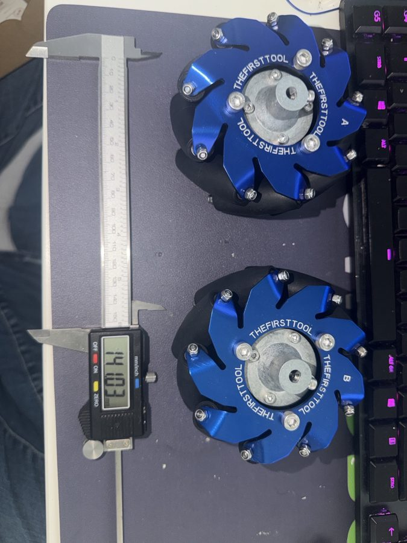
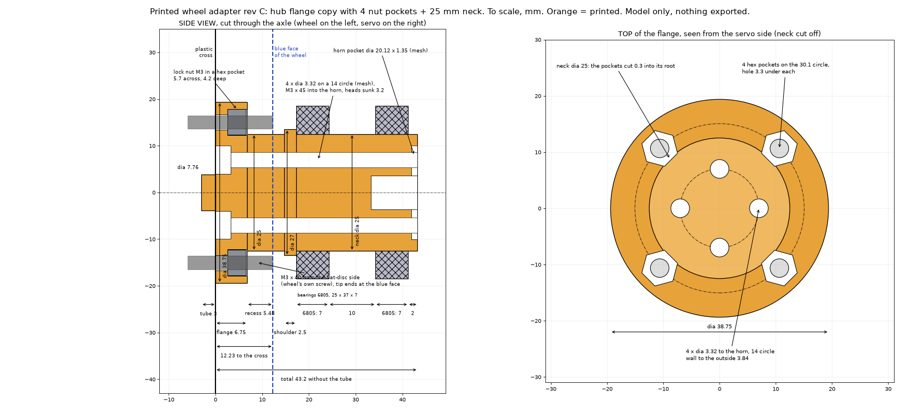
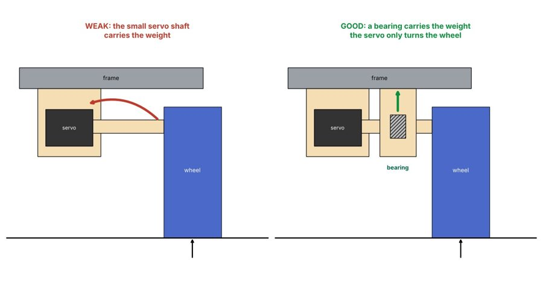
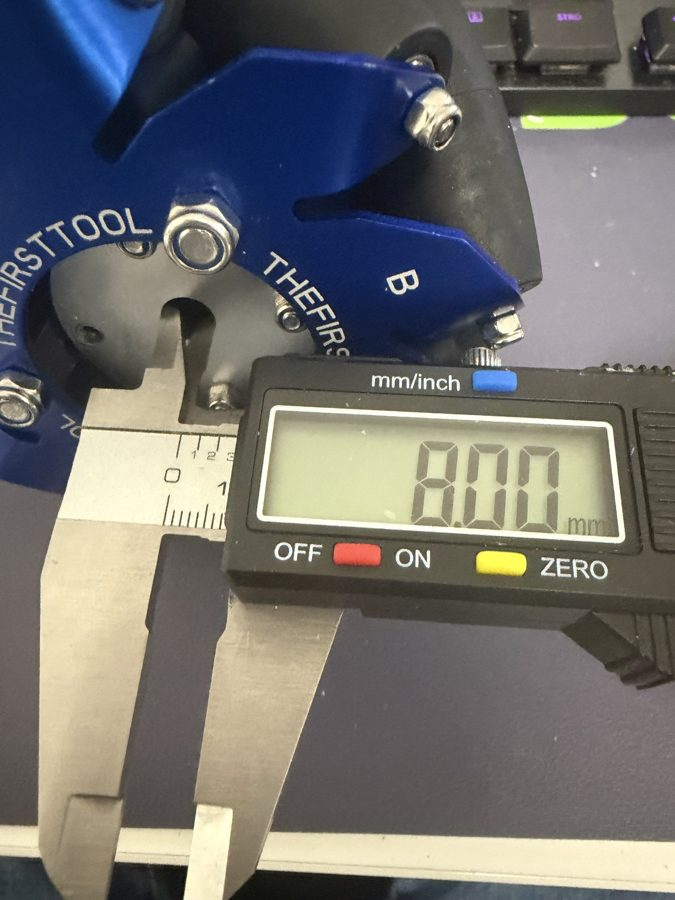
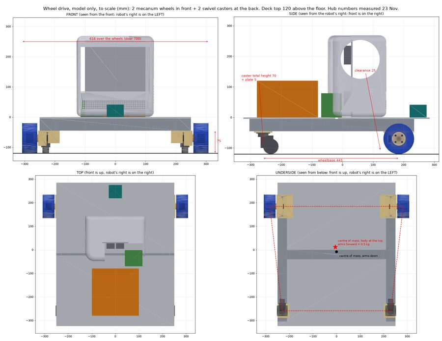

# Phase 10: Mecanum wheel drive

8 to 23 November 2026.

## Goal

Put the new aluminium base on wheels that can also drive sideways, so the robot can place itself exactly along a desk or a machine front.

## Bill of materials

Names only. Photos are the real parts from this build.

| # | Component | Used for | Photo |
|---|---|---|---|
| 1 | Mecanum wheels 100 x 50 mm, left and right (two now, a set of four ordered) | Drive wheels |  |
| 2 | Wheel servos (the kit's STS3215) with horn 20 mm across, about 2.4 mm thick, four holes on a 14 mm circle | Turn the wheel | — |
| 3 | Printed adapters (copy of the hub flange: 38.75 mm across, 6.75 mm thick, four 3.3 mm holes on a 30.1 mm circle, 7.76 mm centre tube) | Join the wheel to the servo |  |
| 4 | Printed brackets under the frame, PETG | Carry the wheel's weight through bearings |  |
| 5 | Two 6805 ball bearings (25 x 37 x 7 mm) per wheel | The wheel's weight goes through them, the servo only turns the wheel | — |
| 6 | M3 x 40 screws with lock nuts | Clamp the wheel sandwich and the adapter | — |
| 7 | Two swivel casters, 70 mm height | Rear support until the set of four arrives | — |
| 8 | Caliper | Measure every part before drawing it |  |

## Simulated wheel drive on the base

## Build notes

1. Rule: full simulation before printing or buying anything.
2. Each wheel is a sandwich: metal hub on one side, flat disc on the other, a black plastic cross between them, clamped by four M3 x 40 screws with lock nuts.
3. The metal hub is made for a round motor shaft, so it comes off. Take out only the four small screws, leave the big ones.
4. Measure the hub with a caliper: flange thickness 6.75 mm, flange diameter 38.75 mm, hole spacing, centre tube 7.76 mm.
5. Print an adapter that copies the hub flange. The wheel's weight goes through ball bearings into a bracket. The servo only turns the wheel.
6. Revision C: neck 25 mm in two 6805 bearings. The wheel's four screws go in from the outside into their own lock nuts, in pockets in the adapter.
7. Until the set of four arrives: two wheels in front, two swivel casters at the back.
8. Print the load-bearing parts in PETG. For two wheels: 2 adapters, 2 brackets, 2 caster plates, about 324 g.

## Problems and fixes

| Problem | Fix |
|---|---|
| Three weeks of waiting for the wheel set | Two single wheels in the meantime |
| The wheel is 100 mm, the kit wheel 127 mm, the axle sits 13.5 mm lower | The bracket sets the height, the caster is bought to match |
| First caliper numbers did not match the photos | Measured again with photos of the caliper: 8.00 and 33.01 mm |
| The kit's 30 mm neck does not fit next to the wheel's screw heads | Neck reduced to 20 mm, then revision C with 25 mm |
| 20 mm neck failed once its four screw holes were counted | Screws enter from the other side, safety 5.8 by hand calculation |
| Screws into the servo horn planned 45 mm would go through the 2.4 mm horn | M3 x 40 with deeper head pockets |
| With casters the robot cannot climb a 10 mm door sill | Fine for flat floors, four mecanum wheels pass. Home sills not measured. |

## Status

Designed and simulated, revision C. Nothing printed, nothing bought yet. Simulation: width 616 mm against a 700 mm door, speed about 0.24 m per second, tip-over margin 172 mm based on estimated weights.

## Wiring notes

Software and mechanics only in this phase. No new wiring.
